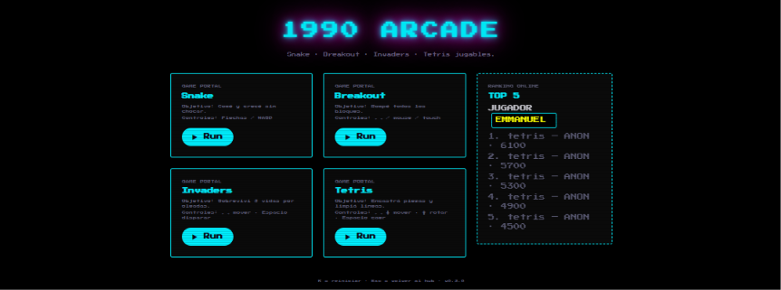
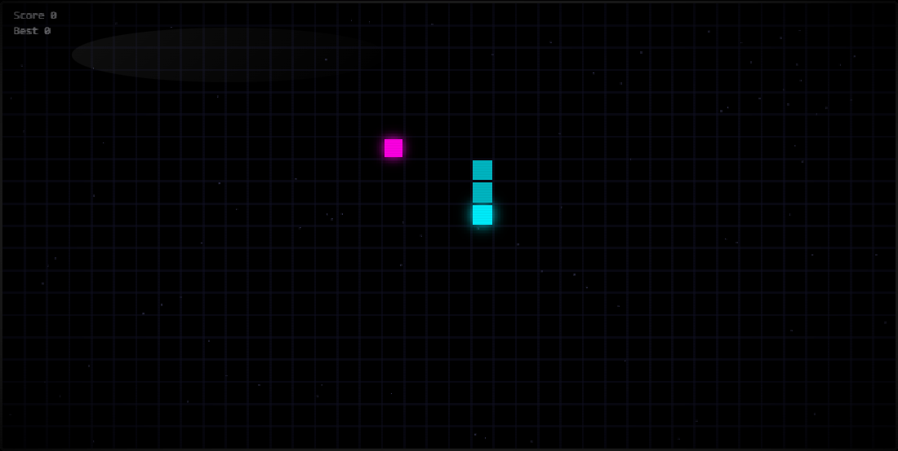
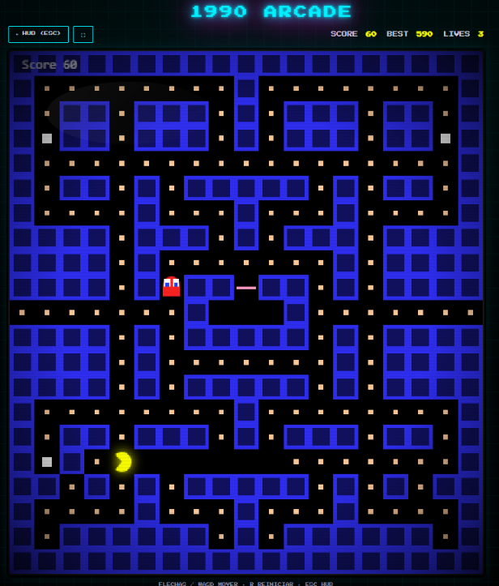
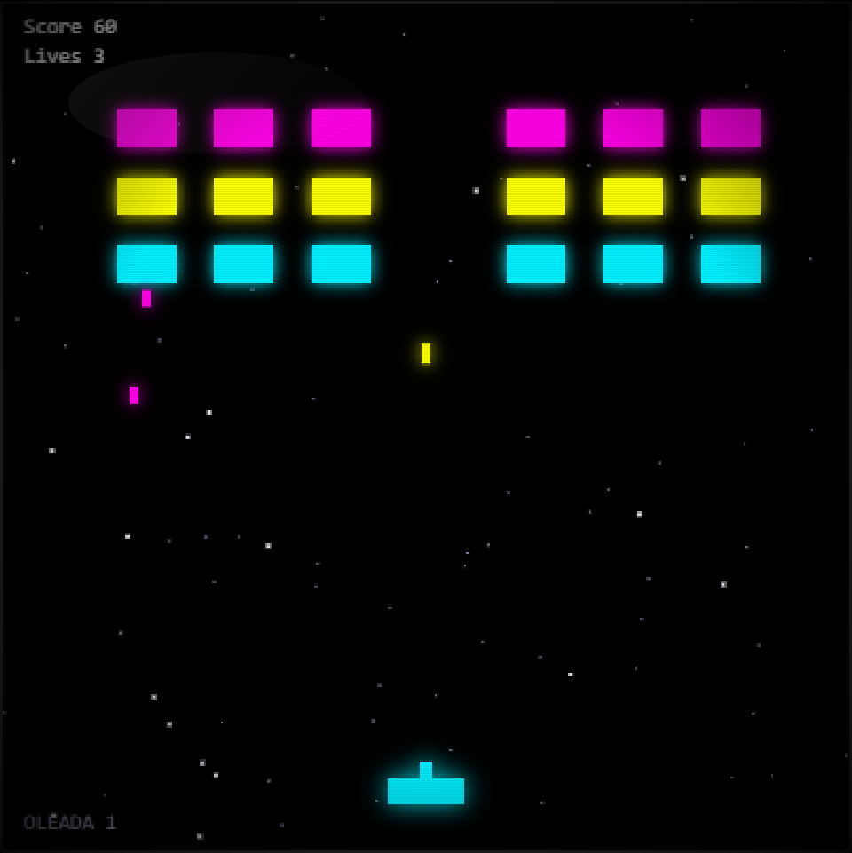
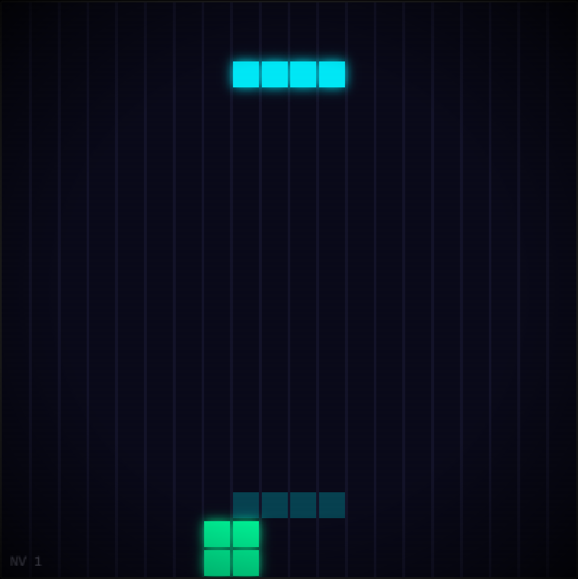
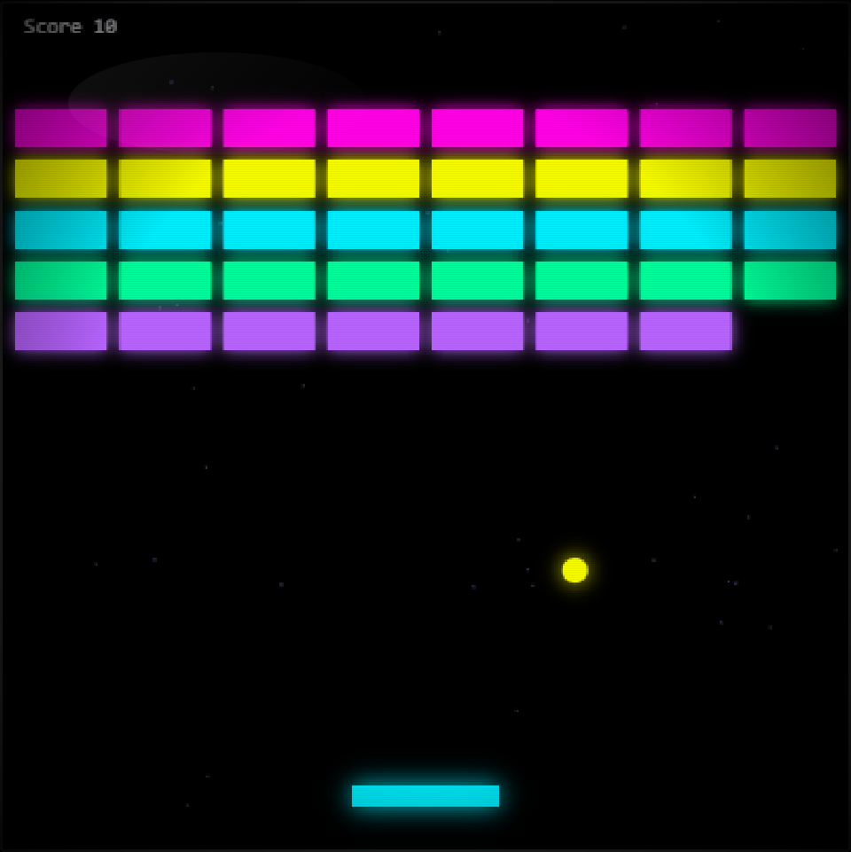

# 1990 ARCADE



[](https://1990-arcade.pages.dev/)
[](package.json)
[](https://1990-arcade.pages.dev/#/)
[](src/main.js)
[](vite.config.js)
[](tests/)

```
┌──────────────────────────────────┐
│  ███  1990 ARCADE  ███           │
│  ▓▓▓  5 PORTALES   ▓▓▓           │
│  ███  INSERT COIN  ███           │
└──────────────────────────────────┘
```

## Descripción
Colección de mini‑juegos retro (Snake, Pac-Man, Invaders, Tetris, Breakout) construidos con Vite, JavaScript vanilla y Tailwind CSS. Neón + CRT, ranking online, PWA instalable y récords por juego.

| Portal | Objetivo | Controles |
|---|---|---|
| ■ Snake | Comé y crecé sin chocar | Flechas / WASD · `1` |
| ■ Pac-Man | Comé todos los puntos sin que te atrapen | Flechas / WASD · `2` |
| ■ Invaders | Sobreviví 3 vidas por oleadas | ← → mover · Espacio · `3` |
| ■ Tetris | Encastrá piezas y limpiá líneas | ← → ↓ · ↑ rotar · Espacio · `4` |
| ■ Breakout | Rompé todos los bloques | ← → / mouse / touch · `5` |

## Galería

| Snake | Pac-Man |
|---|---|
|  |  |

| Invaders | Tetris |
|---|---|
|  |  |

| Breakout |
|---|
|  |

## Desarrollo
```bash
npm install        # instalar dependencias (solo una vez)
npm run dev        # iniciar servidor local (http://localhost:5173)
```

## Tests
```bash
npm run test       # ejecutar los tests con Vitest
```

## Controles globales
`R` reiniciar · `Esc` volver al hub · `1-5` lanzar juego · `1990` alterna paleta matrix/neón.

## Contribuir
1. Forkea el repositorio.
2. Crea una rama descriptiva (`feat/…` o `fix/…`).
3. Ejecuta `npm install` y `npm run test` para asegurarte de que todo pasa.
4. Haz commit con mensaje *conventional* y push a tu fork.
5. Abre un Pull Request contra la branch `main`.

## Deploy
El proyecto se despliega automáticamente a Cloudflare Pages mediante GitHub Actions al hacer merge en `main`.
