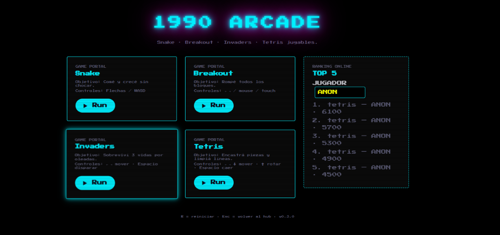

# 1990 ARCADE

Hub retro con 4 minijuegos jugables + ranking online. Jugá acá: **https://1990-arcade.pages.dev/**



## Juegos

| Juego     | Objetivo                          | Controles                                              |
|-----------|-----------------------------------|--------------------------------------------------------|
| Snake     | Comé y crecé sin chocar           | Flechas / WASD · touch swipe                           |
| Breakout  | Rompé todos los bloques           | ← → / A D · mouse / touch                              |
| Invaders  | Sobreviví 3 vidas por oleadas     | ← → mover · Espacio disparar                           |
| Tetris    | Encastrá piezas y limpiá líneas   | ← → ↓ mover · ↑ rotar · Espacio caída dura             |

Comunes: `R` reinicia · `Esc` vuelve al hub · `⛶` pantalla completa.
Alias gabinete: `X/V/C` acción · `Z/H` volver.
Easter egg: tecleá `1990` para modo matrix.

## Ranking online

Los récords se guardan en Cloud Firestore (`scores`: `{game, name, score, at}`) y el hub muestra el TOP 5. Reglas: lectura pública, solo creación validada (score numérico 0–999999, nombre ≤ 12), sin update/delete. El nombre se escapa al renderizar (XSS).

## Stack

Vite 6 + JS vanilla + Tailwind CSS v4 + Firebase Firestore (CDN) + Cloudflare Pages.

## Local

```bash
npm install
npm run dev      # http://localhost:5173
npm run build    # dist/
npm run preview  # http://localhost:4173
```

## Deploy

Build de un solo archivo (`deploy/index.html` generado desde `dist/`) subido a Cloudflare Pages por carga directa.

## Licencia

MIT — ver [LICENSE](LICENSE).
